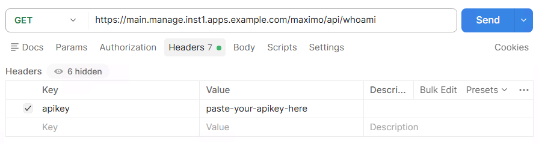

# Setting up Postman

Postman lets you send requests to the Maximo Manage REST API on MAS without writing code. Set it up once, and every recipe in this cookbook works the same way.

## What you need

- A Manage API key, created in the Manage **API Keys** application.
- The Manage URL for your MAS instance. It follows this pattern:

```
https://<workspace>.manage.<instance>.<domain>/maximo
```

## Install Postman

- Download the Postman desktop app from [postman.com/downloads](https://www.postman.com/downloads/).
- Install it. No admin rights are needed.
- Open Postman, create an account with your email and sign in.
- You can also try their web app!

## Send your first request

Create a new request:

```http
GET https://<workspace>.manage.<instance>.<domain>/maximo/api/whoami
apikey: <your Manage API key>
```

For example: `https://main.manage.inst1.apps.example.com/maximo/api/whoami`

Click **Send**. A **200 OK** with your user's details means Postman is ready.

Below is an example of what your Postman should look like before hitting the blue Send button.



### No response on a corporate network?

If your company routes traffic through a proxy, Postman can pick it up and never reach Manage. Open **Settings > Proxy**, untick **Use the system proxy**, and send the request again.

## Use the cookbook collection

- In Postman, click **Import** and select `postman/maximo-api-cookbook.postman_collection.json` from this repository.
- In the collection's **Variables**, set `baseUrl` to your Manage URL (ending in `/maximo`).
- Put your API key in a Postman **environment** as `apikey`, not in the collection. The requests send it as an `apikey` header, read from that variable.
- Run **01 Who am I**.

Never commit or share a collection or environment that holds a real API key.

Back to the [cookbook](../README.md).
