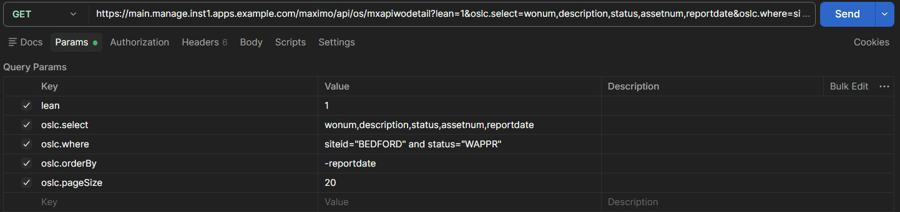

# 02 · Querying records

**Goal:** pull only the records and fields you need, in plain JSON.

> Tested on: Maximo Manage 9.0 (sandbox with the Maximo demo data)

## The request

Work orders waiting for approval at site BEDFORD, newest first:

```http
GET https://<workspace>.manage.<instance>.<domain>/maximo/api/os/mxapiwodetail?lean=1&oslc.select=wonum,description,status,assetnum,reportdate&oslc.where=siteid="BEDFORD" and status="WAPPR"&oslc.orderBy=-reportdate&oslc.pageSize=20
apikey: <your-api-key>
```

For example:

```
https://main.manage.inst1.apps.example.com/maximo/api/os/mxapiwodetail?lean=1&oslc.select=wonum,description,status,assetnum,reportdate&oslc.where=siteid="BEDFORD" and status="WAPPR"&oslc.orderBy=-reportdate&oslc.pageSize=20
```

Paste the URL into Postman and it splits the parameters into the **Params** tab for you, and encodes the quotes and spaces when it sends. Add the `apikey` header as in [recipe 01](01-authentication.md). Below is what your Postman should look like before you click the blue **Send** button.



In the Postman collection this is **02 Query work orders**. The site comes from the collection variable `siteid`.

## What each parameter does

| Parameter | Purpose |
|---|---|
| `lean=1` | Plain JSON, no `spi:`/`rdf:` prefixes. Use it on every call |
| `oslc.select` | Only the fields you list. Without it you get every field, which is slow |
| `oslc.where` | The filter. Strings in double quotes, combine with `and` / `or` |
| `oslc.orderBy` | `-field` sorts descending, `+field` ascending. The sign is required, and in a URL the `+` must be written as `%2B` (see Gotchas) |
| `oslc.pageSize` | Records per page (see recipe 04 for paging) |

## Useful `oslc.where` patterns

All of these returned results on the demo data:

```text
status in ["APPR","INPRG"]
reportdate>="2021-01-01T00:00:00-05:00"
description="%pump%"                     (contains "pump")
assetnum="11430" and siteid="BEDFORD"
```

Child fields: `oslc.select=wonum,assetnum,asset.description` pulls a field from the related asset in the same call. It comes back nested:

```json
{ "wonum": "43041", "assetnum": "11430", "asset": { "description": "Centrifugal Pump 100GPM/60FT HD" } }
```

## Sample response (trimmed)

The first record from the request above:

```json
{
  "member": [
    {
      "wonum": "T1228",
      "description": "Clean bearing bracket",
      "status": "WAPPR",
      "status_description": "Waiting on approval",
      "_rowstamp": "580653",
      "href": "https://<workspace>.manage.<instance>.<domain>/maximo/oslc/os/mxapiwodetail/_QkVERk9SRC9UMTIyOA--",
      "worklog_collectionref": "https://<workspace>.manage.<instance>.<domain>/maximo/oslc/os/mxapiwodetail/_QkVERk9SRC9UMTIyOA--/woworklog"
    }
  ],
  "responseInfo": {
    "nextPage": { "href": "...?pageno=2&..." },
    "href": "...",
    "pagenum": 1
  }
}
```

Notice what's missing and what's extra:

- **No `assetnum` or `reportdate`.** This work order has neither, and `lean=1` leaves empty fields out instead of sending `null`. Your code has to handle a missing key.
- **`status_description`** comes along on its own, so you get the readable status without asking for it.
- **`*_collectionref` links**, one per child collection (worklog, labor, materials and so on). I got 21 of them on every record, even with `oslc.select=wonum`. Skip them unless you need to follow one.

Keep the `href`: it's how you update this exact record (recipe 03).

## Gotchas

- **Ascending sort needs `%2B`, not `+`.** In a URL a bare `+` means a space, so `oslc.orderBy=+statusdate` returns a 400 (BMXAA8744E, query not parsed). Write `oslc.orderBy=%2Bstatusdate`. Leaving the sign off (`oslc.orderBy=statusdate`) gives the same 400.
- **Empty values sort first when you sort descending.** On the demo data, `oslc.orderBy=-reportdate` puts the work orders with no report date at the top. To skip them, add a date filter such as `reportdate>="2000-01-01T00:00:00-05:00"`. `reportdate!="*null*"` doesn't work on a date field: it returns a 400 (BMXAA4144E, date format not valid).
- **Demo data is old.** Most demo work orders are dated 1998 to 2021, so a "this year" date filter returns nothing. That's a valid empty result, not an error.
- Field names in `oslc.select` and `oslc.where` are lowercase attribute names.
- Use `oslc.select=*` only while exploring. Never use it in an integration.
- Date filters need the full ISO format with a time zone offset.
- Use the `href` as Maximo returns it, even though its path says `/oslc/os/` rather than `/api/os/`, and its host can differ from the one you called (on my sandbox it dropped the port).
